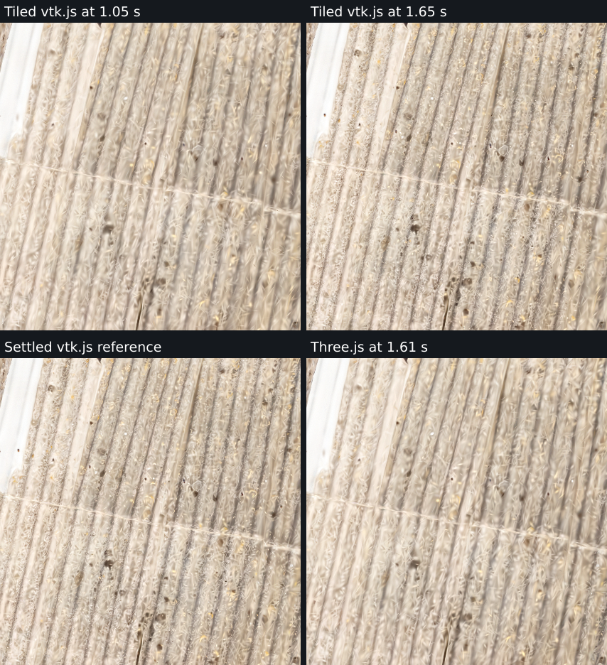

# Svirnas roof detail

The camera holds on the roof from route time 5.7 s to 7.3 s. The four panels use the same camera pose, viewport and crop. The top row follows one cold run of tiled-vtkjs from the one-second sample to the end of the hold. The bottom row shows the fully converged tiled-vtkjs reference and the timed Three.js 3D Tiles viewer. The quantitative gate compares tiled-vtkjs against its own reference. Three.js uses a different Gaussian appearance model.



The roof edge-error limit is 0.350. The sustained gate requires the crop to pass all quality thresholds within one second and remain passing for at least 500 ms. Each run started with a fresh browser context. Elapsed times below are relative to the start of the roof hold. [Per-sample measurements](./roof-results.json)

| Run | End-of-hold capture | Edge error at capture | First passing recovery sample | Sustained within 1 s |
| --- | ------------------: | --------------------: | ----------------------------: | -------------------- |
| 1   |              1.65 s |                 0.031 |                        1.30 s | no                   |
| 2   |              1.65 s |                 0.030 |                        1.30 s | no                   |
| 3   |              1.65 s |                 0.678 |                          none | no                   |

At the same pose the fully settled SSE 12 crop was pixel-identical to the higher-detail SSE 6 reference. The measured limitation at this roof is time to present that detail during motion.

## Reproduce

Use the [reference viewer setup](../README.md) and run these commands from the repository root. Copy the contents of the pinned Svirnas sample directory, including its build summary and tiles, into `artifacts/svirnas-capture/svirnas/`. The recorded camera is in local coordinates. Remove the georeferencing transform from the copy. [Source tiles and converter attribution](https://github.com/WilliamLiu-1997/3D-Tiles-RendererJS-3DGS-Plugin/tree/86bf498a10158dabc2822d1b5f13ea858e26629e/data/SvirnasAlyt-3dtiles)

```bash
python3 - <<'PY'
import json
from pathlib import Path

manifest = Path("artifacts/svirnas-capture/svirnas/tileset.json")
document = json.loads(manifest.read_text())
document["root"].pop("transform", None)
manifest.write_text(json.dumps(document) + "\n")
PY

p=artifacts/svirnas-capture-results
mkdir -p "$p"
node test/reference-viewers/recorded-route.mjs test/reference-viewers/svirnas/scene.json "$p/route.json"
node test/reference-viewers/run.mjs --manifest "$p/route.json" --case vtk-sse-12 --case three-sse-12 --gpu --latency 40 --mbps 80 --coverage --checkpoints --out "$p/motion"
node test/reference-viewers/run.mjs --manifest "$p/route.json" --case vtk-sse-6-reference --gpu --latency 40 --mbps 80 --coverage --checkpoints --settled-reference --out "$p/reference"
node test/reference-viewers/score-checkpoints.mjs "$p/motion/vtk-sse-12-1.json" "$p/reference/vtk-sse-6-reference-1-settled-reference.json" test/reference-viewers/svirnas/policy.json
```

The scorer reports each stop independently and exits with status 1 if any gate misses. The timed run uses SSE 12 and 256 MiB. Only the reference uses SSE 6, 768 MiB and a six-million-splat limit. Capture hardware was a laptop RTX 3000 Ada with ANGLE D3D11 at 960 × 720. Latency and throughput shaping apply per request.
